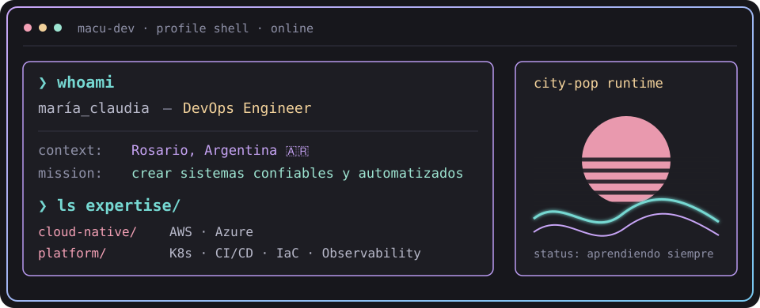

<!-- LOCAL CITY-POP BANNER -->
<a href="https://github.com/CrisDSS8">
  <picture>
    <source media="(prefers-color-scheme: dark)" srcset="assets/banner-dark.v9.svg">
    <source media="(prefers-color-scheme: light)" srcset="assets/banner-light.v9.svg">
    
  </picture>
</a>

 

---

## `$ whoami`

  

 

## `$ cat tech-stack.yaml`

<table border="1" cellpadding="14" bgcolor="#17171c">
  <thead>
    <tr>
      <th colspan="2" align="left"><code>macu-dev:~$ cat tech-stack.yaml</code></th>
    </tr>
  </thead>
  <tbody>
    <tr>
      <td width="50%" valign="top"><code>├─ 🛡️ cybersecurity_tools:</code>  
         
        <code>Linux · Bash · C++ · Python · Figma</code>
      </td>
      <td width="50%" valign="top"><code>├─ ✦ languages_frameworks:</code>  
         
        <code>Python · JavaScript · HTML · CSS · C++</code>
      </td>
    </tr>
    <tr>
      <td width="50%" valign="top"><code>├─ 🐧 sysadmin_automation:</code>  
         
        <code>Linux · Bash · PowerShell · Git · GitHub</code>
      </td>
    </tr>
    <tr>
      <td valign="top"><code>├─ ✦ languages_scripting:</code>  
         
        <code>Python · JavaScript · C++ · C · Bash · PowerShell</code>
      </td>
      <td valign="top"><code>╰─ 🛠️ tools_and_security:</code>  
         
        <code>Linux · Git · GitHub · Figma · MATLAB</code>
      </td>
    </tr>
  </tbody>
  <tfoot>
    <tr>
      <td colspan="2"><code>status: ready&nbsp;&nbsp;·&nbsp;&nbsp;environment: production</code></td>
    </tr>
  </tfoot>
</table>

---

## `$ kubectl get signals --all-namespaces`

  <picture>
    <source media="(prefers-color-scheme: dark)" srcset="assets/radar-dark.svg">
    <source media="(prefers-color-scheme: light)" srcset="assets/radar-light.svg">
    
  </picture>&nbsp;
  <picture>
    <source media="(prefers-color-scheme: dark)" srcset="assets/radar-langs-dark.svg">
    <source media="(prefers-color-scheme: light)" srcset="assets/radar-langs-light.svg">
    
  </picture>

<code>signals: devops_skill_radar · language_stack_radar · status: healthy</code>

---

<!-- SOCIALS -->
## `$ connect --socials`

&nbsp;&nbsp;
&nbsp;&nbsp;

 
 

Oh well, Whatever happens, happens... - Spike Spiegel

